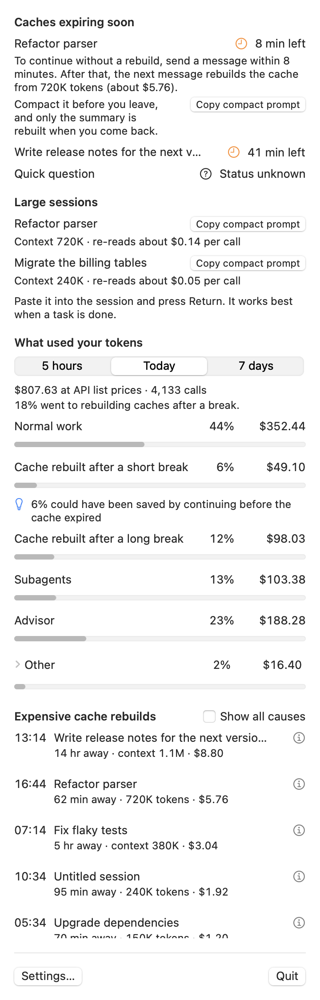

# Tokens Are Running Out

> **Where did my tokens go?** · 내 토큰 어디 갔어?

A macOS menu bar app that tells you **why** your Claude Code usage drained, not just how much is left.

Most usage tools show a gauge. This one reads your local Claude Code transcripts and explains where the spend came from, so you can change what you do next time.

<p align="center">
  <picture>
    <source media="(prefers-color-scheme: dark)" srcset="docs/images/popover-dark.png">
    
  </picture>
</p>

> **Status: released.** Install it with Homebrew from [bingoring/homebrew-tap](https://github.com/bingoring/homebrew-tap) or download a signed and notarized build from [Releases](https://github.com/bingoring/tokens-are-running-out/releases). The design and its approval gates live in [`docs/dlc/projects/tokens-are-running-out`](docs/dlc/projects/tokens-are-running-out/STATUS.md) ([Waypoint](https://github.com/bingoring/waypoint)).

## What it does

- **Break usage down by cause.** For the last 5 hours, today and the last 7 days, it splits API-price-equivalent cost into normal work, cache rebuilds after a short break, cache rebuilds after a long break, subagents, advisor consults and other causes.
- **Warn before a cache expires.** When an idle session's prompt cache is about to expire, it shows how long is left and how many tokens a resume would have to write again. If you turn it on, it also sends a notification ahead of time. The notification shows the session's title, so it can appear wherever macOS shows notifications.
- **List the costly rebuilds.** It lists each cache rebuild with the session, the break before it and the rule that classified it.
- **Point out large sessions.** It lists running sessions whose context has passed 200K tokens, with what each call re-reads at list price, and copies a `/compact` prompt that keeps the goal, decisions, files, state and remaining work. You paste it into the session yourself; the app never runs it.

## What it will never do

- Read your login tokens, keychain or cookies.
- Send anything over the network. It has no telemetry.
- Spend your quota, for example by pinging sessions to keep the cache warm.
- Write to `~/.claude`. It only reads.

## Install

Requires macOS 14 or later, on Apple silicon or Intel. So far it has been tested only on macOS 27 on Apple silicon. If you run it on an Intel Mac or on macOS 14 to 26, please [open an issue](https://github.com/bingoring/tokens-are-running-out/issues/new/choose) and say how it went.

With [Homebrew](https://brew.sh):

```bash
brew install --cask bingoring/tap/tokens-are-running-out
```

Or download `TokensAreRunningOut-<version>.zip` from [Releases](https://github.com/bingoring/tokens-are-running-out/releases), unzip it and move `TokensAreRunningOut.app` to Applications. The app is signed with a Developer ID and notarized by Apple, so it opens without a Gatekeeper warning. To check a download, put the `.sha256` file from the same release next to the zip and run:

```bash
shasum -a 256 -c TokensAreRunningOut-<version>.zip.sha256
```

The index lives in `~/Library/Application Support/TokensAreRunningOut/`; deleting it is safe, the app rebuilds it. `brew uninstall --zap --cask tokens-are-running-out` removes the app, its index and its settings.

## Build from source

Requires Xcode 26.

```bash
scripts/build-app.sh
```

```bash
open .build/apps/TokensAreRunningOut.app
```

The script builds with `xcodebuild` (which compiles the English and Korean strings) and signs the app ad hoc. `scripts/build-app.sh --release 1.2.3` builds the universal (Apple silicon and Intel) app with that version.

## Prototype

[`prototype/drain.py`](prototype/drain.py) counts and classifies cache rebuilds in your local transcripts. It is read-only and needs only Python 3:

```bash
python3 -I prototype/drain.py --from 2026-11-10T00:00:00Z --to 2026-11-17T00:00:00Z
```

The Swift app must reproduce its numbers exactly for the same window.

## Releasing

For maintainers. Pushing a tag runs the [Release workflow](.github/workflows/release.yml):

```bash
git tag v1.2.3
```

```bash
git push origin v1.2.3
```

- `v1.2.3-rc.1` makes a GitHub pre-release and leaves the Homebrew cask alone. A pre-release can be tagged on a pull request's branch to try the pipeline.
- `v1.2.3` makes a release and points the cask in [bingoring/homebrew-tap](https://github.com/bingoring/homebrew-tap) at it. It must be tagged on a commit on `main`, and it only moves the cask forward: an older version leaves the cask as it is.
- Before anything is signed, the workflow runs the same build, tests and anti-goal checks as CI and checks the built app for network code and entitlements. Then it signs the universal app with the Developer ID (hardened runtime), notarizes it, staples the ticket and attaches the zip and its SHA-256. It never replaces an existing release.
- The release job waits until a required reviewer approves it under the run's **Review deployments**. Its secrets live in the `release` environment, which only `v*` tags and `main` can use.
- If only the Homebrew step fails, for example because the token expired, register a new token and run the **Update Homebrew tap** workflow from `main` with the tag. It does not rebuild, and it waits for the same approval. The same workflow can also move the cask back to an older release.

The workflow needs these secrets in the `release` environment. Keep none of them as repository secrets: a workflow that leaves out `environment: release` could read those without approval.

| Secret | Value |
| --- | --- |
| `DEVELOPER_ID_P12_BASE64` | The Developer ID Application certificate and its private key, exported as `.p12`, in base64 |
| `DEVELOPER_ID_P12_PASSWORD` | The `.p12` export password |
| `NOTARY_KEY_P8_BASE64` | An App Store Connect team API key (`.p8`, Developer access), in base64 |
| `NOTARY_KEY_ID` | That key's ID |
| `NOTARY_ISSUER_ID` | The issuer ID shown above the team keys |
| `TAP_TOKEN` | A fine-grained token with Contents read and write on `bingoring/homebrew-tap` only. Stable releases need it |

Set them in your own terminal, from files or the prompt, so the values never land in the shell history. For example:

```bash
base64 -i DeveloperID.p12 | gh secret set DEVELOPER_ID_P12_BASE64 --env release
```

```bash
gh secret set DEVELOPER_ID_P12_PASSWORD --env release
```

To try the signing steps without secrets, build and run the release script with `--dry-run`, which signs ad hoc and skips notarization:

```bash
scripts/build-app.sh --release 1.2.3 && scripts/release.sh --version 1.2.3 --dry-run
```

## License

[MIT](LICENSE)
